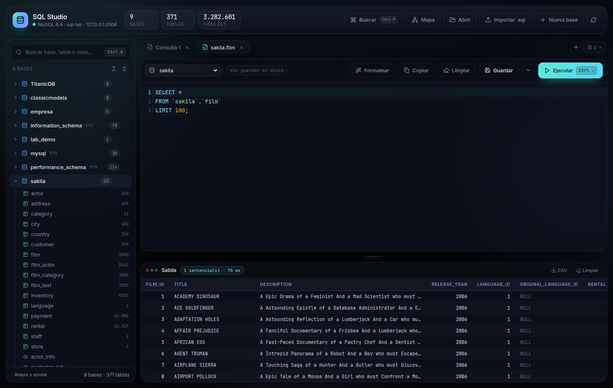
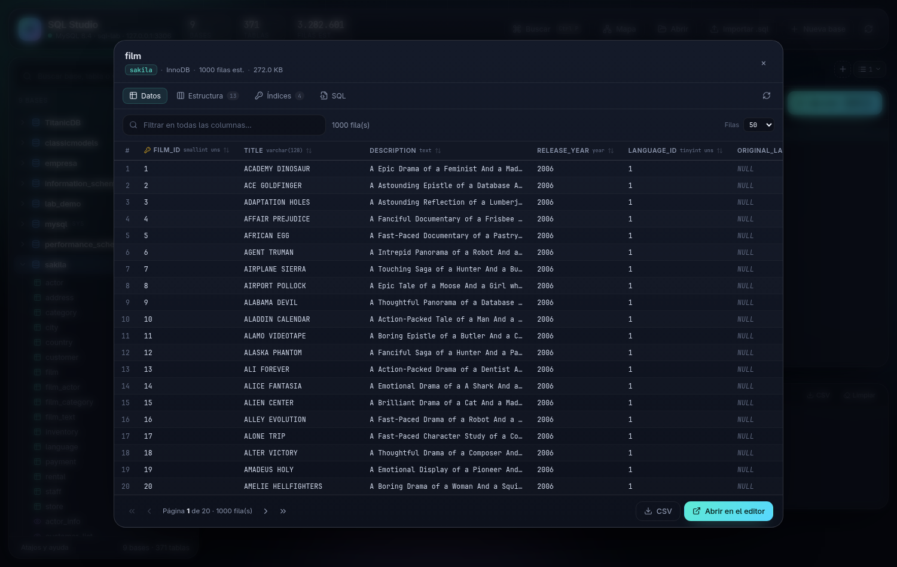
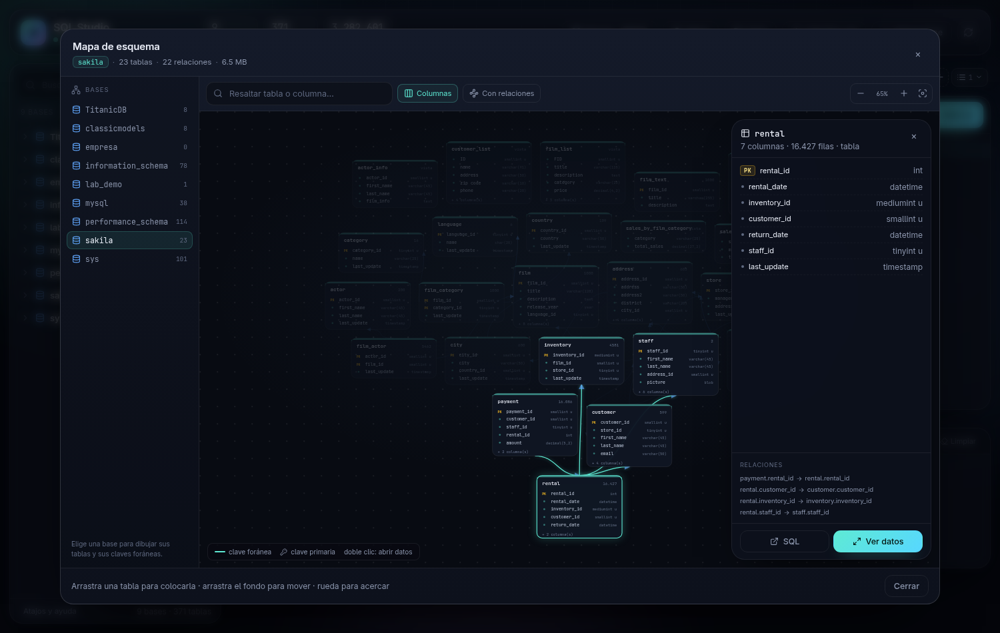
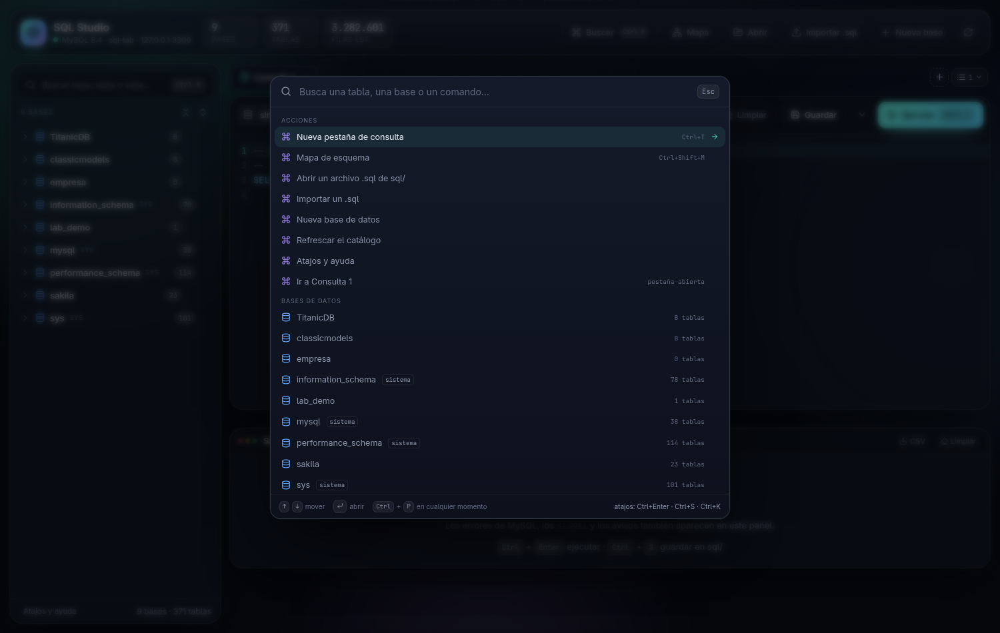
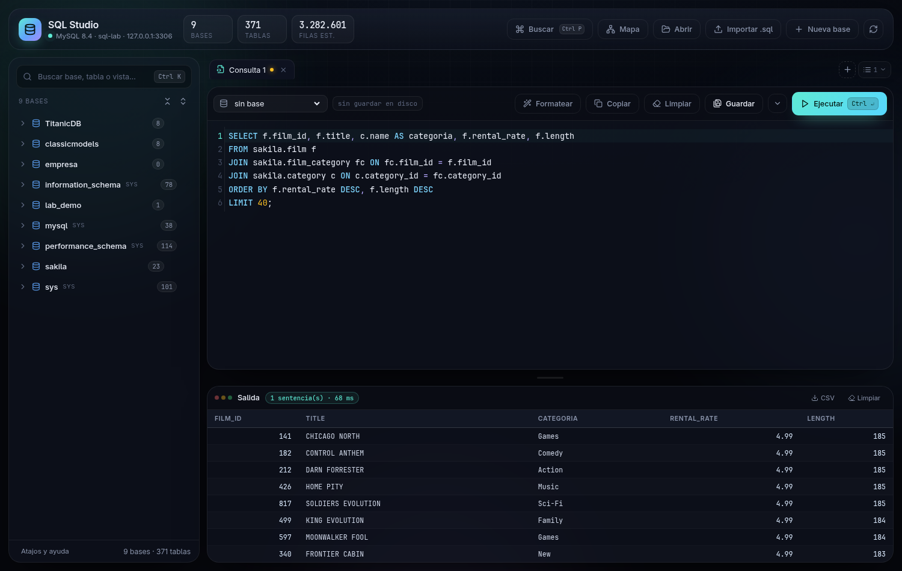

<div align="center">


# SQL Studio Lab

**Un laboratorio MySQL local, bonito y sin fricción: interfaz gráfica, terminal y datos que sobreviven a todo.**

[](https://github.com/TU-USUARIO/sql-studio-lab/actions/workflows/ci.yml)
[](LICENSE)
[](https://dev.mysql.com/doc/relnotes/mysql/8.4/)
[](https://www.python.org/)
[](https://react.dev/)

</div>



## Qué es

SQL Studio Lab levanta **un único contenedor MySQL 8.4** y pone encima una
aplicación web local para explorar bases, escribir SQL y entender los datos.
No hay servidor remoto, ni cuenta, ni telemetría: todo corre en tu máquina y
los datos viven en `volumen/`, dentro del propio repositorio.

Incluye tres formas de trabajar:

- **Interfaz gráfica** en `http://127.0.0.1:8765` (o en una ventana propia de
  Chromium con `./sql-studio`).
- **CLI `sql-lab`** para cargar scripts, abrir la shell de MySQL, editar con
  nano, ejecutar pruebas declarativas y ver el estado del contenedor.
- **API HTTP local** sin dependencias, útil para automatizar o integrar.

## Características

### Editor y ejecución

- CodeMirror 6 con resaltado SQL propio, numeración, autocompletado y plegado.
- Pestañas ilimitadas con sesión recordada, indicador de cambios sin guardar,
  tira desplazable y menú de pestañas para no perder ninguna.
- `Ctrl + Enter` ejecuta todo el editor o solo la selección; cada sentencia
  muestra su tipo, tiempo, filas afectadas y `LAST_INSERT_ID`.
- Panel de resultados con chips por sentencia, `NULL` diferenciado, columnas
  numéricas alineadas, exportación a CSV y errores con código y `SQLSTATE`.
- Guardar y abrir `.sql` en `sql/`: escritura atómica, nombre validado y
  diálogo de «Guardar como» con aviso de sobrescritura.

### Exploración visual

- **Árbol completo** de bases, tablas, vistas, triggers y rutinas, con búsqueda,
  recuento de filas y plegado/despliegue global.
- **Inspector de tabla** en ventana: datos paginados, orden por cualquier
  columna, búsqueda en todas las columnas, detalle de fila en JSON, estructura,
  índices, DDL y SQL listo para abrir en el editor.
- **Mapa de esquema** interactivo: dibuja las tablas y sus claves foráneas con
  zoom, arrastre, búsqueda, filtro de tablas relacionadas y panel lateral con
  columnas y relaciones. Doble clic en una tabla abre sus datos.
- **Paleta de comandos** (`Ctrl + P`): busca bases, tablas, pestañas y acciones,
  o recupera consultas recientes del historial local.
- **Importar `.sql`** arrastrando el archivo, con `DELIMITER`, procedimientos y
  triggers, y resultado sentencia a sentencia.

### Terminal

`sql-lab` es el navaja suiza del laboratorio:

```bash
./sql-lab start                  # crea/arranca el contenedor y espera a MySQL
./sql-lab status                 # estado + bases + objetos
./sql-lab shell sakila           # cliente mysql con historial persistente
./sql-lab edit quickstart        # nano con resaltado y ejecución al salir
./sql-lab run sql/mi_script.sql  # ejecuta un script completo
./sql-lab load sql/examples/quickstart.sql
./sql-lab test                   # casos -- @test: con SIGNAL y prints
./sql-lab list | tables sakila | history | logs
```

### Seguridad por diseño

- MySQL y la app escuchan **solo en `127.0.0.1`**.
- Credenciales en `.env` con permisos `600`, fuera de Git.
- Nombres de tablas/columnas citados y validados; orden y filtros nunca se
  concatenan sin comprobar; los `.sql` se confinan a `sql/`.
- Sin dependencias de Python: solo biblioteca estándar y el cliente `mysql`
  que ya incluye el contenedor.

## Inicio rápido

### Requisitos

- Docker con el plugin Compose (o Docker clásico; hay alternativa con `docker run`).
- Python 3.10+.
- Node.js 18+ **solo** si quieres recompilar el frontend (el repo incluye
  `app/static/` ya compilado).

### Instalación en un comando

```bash
git clone https://github.com/TU-USUARIO/sql-studio-lab.git
cd sql-studio-lab
./install.sh --demo
```

El instalador:

1. Comprueba Docker, Python y Node.
2. Genera `.env` con una contraseña aleatoria.
3. Crea/arranca el contenedor MySQL con volumen persistente.
4. Compila el frontend si hace falta.
5. Arranca la API en `http://127.0.0.1:8765`.
6. Carga la base de ejemplo `quickstart` si pasas `--demo`.
7. Enlaza `sql-studio` y `sql-lab` en `~/.local/bin`.

Opciones útiles:

| Opción | Efecto |
| --- | --- |
| `--demo` | Carga `sql/examples/quickstart.sql` (4 tablas relacionadas). |
| `--desktop` | Crea la entrada «SQL Studio» en el menú de aplicaciones. |
| `--no-start` | Prepara todo pero no arranca la API. |
| `--rebuild` | Fuerza `npm ci` + `npm run build`. |
| `--no-link` | No crea enlaces en `~/.local/bin`. |
| `--port 8765` | Cambia el puerto de la interfaz. |
| `--mysql-port 3306` | Cambia el puerto de MySQL en localhost. |
| `--check` | Solo comprueba dependencias, sin modificar nada. |
| `--status` | Estado del contenedor y del servidor. |
| `--stop` | Para la app y el contenedor sin borrar datos. |

Abre **http://127.0.0.1:8765** o ejecuta `./sql-studio`. Si usaste
`--desktop`, también aparece buscando «SQL Studio» en el menú de aplicaciones.

## Capturas

| Inspector de tabla | Mapa de esquema |
| --- | --- |
|  |  |

| Paleta de comandos | Consultas con JOIN |
| --- | --- |
|  |  |

## Uso diario

```bash
./sql-studio              # ventana de Chromium + servidor
./sql-studio --no-open    # solo servidor
./sql-studio --status
./sql-studio --stop

./sql-lab shell           # terminal MySQL
./sql-lab load sql/examples/quickstart.sql
./sql-lab test            # pruebas declarativas de procedimientos/triggers
```

Atajos de la interfaz:

| Atajo | Acción |
| --- | --- |
| `Ctrl + Enter` | Ejecutar (o la selección) |
| `Ctrl + S` | Guardar en `sql/` |
| `Ctrl + P` | Paleta de comandos |
| `Ctrl + T` / `Ctrl + W` | Nueva pestaña / cerrar |
| `Ctrl + K` | Buscar en el árbol |
| `Ctrl + L` | Limpiar la salida |
| `Ctrl + Shift + M` | Mapa de esquema |

## Estructura

```text
sql-studio-lab/
├── install.sh              instalador completo (Docker + app + CLI)
├── sql-studio              lanzador de la ventana / servidor
├── sql-lab                 CLI del laboratorio MySQL
├── docker-compose.yml      MySQL 8.4 con volumen local
├── .env.example            plantilla de credenciales y puertos
├── app/
│   ├── server.py           API + estáticos (solo stdlib)
│   ├── static/             frontend compilado que sirve la API
│   ├── web/                fuente React + TypeScript + Vite
│   └── tests/              pruebas unitarias y de integración
├── sql/
│   ├── examples/           quickstart.sql y consultas de ejemplo
│   └── tests/              banco de pruebas -- @test:
├── docs/                   arquitectura, API, pruebas y capturas
└── .github/                CI, plantillas de issues y PR
```

El volumen de MySQL es un *bind mount* (`volumen/` → `/var/lib/mysql`). Parar
el contenedor, reiniciar el equipo o actualizar la imagen **no pierde datos**.
Para una copia de seguridad: `./install.sh --stop` y copia `volumen/`.

## Configuración

`.env` (generado por el instalador, ignorado por Git):

```dotenv
MYSQL_ROOT_PASSWORD=...   # contraseña aleatoria de root
MYSQL_PORT=3306           # puerto de MySQL en 127.0.0.1
SQL_STUDIO_PORT=8765      # puerto de la interfaz
```

No cambies la contraseña de `.env` con el volumen ya creado sin cambiarla
también dentro de MySQL: el contenedor solo aplica la contraseña al inicializar
el volumen.

## Pruebas

| Batería | Casos | Qué cubre |
| --- | ---: | --- |
| Unitarias (`test_unit.py`) | 33 | Separador SQL, `DELIMITER`, errores, literales, rutas seguras. |
| API (`test_api.py`) | 79 | Catálogo, consultas, DML, SIGNAL, importación, ficheros, inspector, mapa y seguridad. |
| Interfaz (`tests/ui.html`) | 41 | Clics reales en Chromium: pestañas, inspector, mapa, paleta, historial y guardado. |

```bash
python3 app/tests/test_unit.py          # sin Docker
./install.sh                            # deja la API en marcha
python3 app/tests/test_api.py           # contra MySQL real
cd app/web && node tools/ui-run.mjs http://127.0.0.1:8765/tests/ui.html
```

La integración necesita el contenedor y la API en marcha. CI ejecuta las
unitarias, compila TypeScript/Vite y valida la sintaxis de los scripts; las
pruebas de API e interfaz se ejecutan en local porque necesitan Docker y
Chromium. Más detalle en [docs/TESTING.md](docs/TESTING.md).

## API

La API escucha en `127.0.0.1` y no tiene autenticación: está pensada para uso
local. Endpoints principales:

```text
GET  /api/health            estado del contenedor
GET  /api/databases         bases, tablas, tamaño y filas estimadas
GET  /api/schema?db=        tablas, columnas, rutinas y triggers
GET  /api/relations?db=     tablas + claves foráneas para el mapa
GET  /api/table?db=&table=  metadatos + página de datos
GET  /api/rows?db=&table=   solo una página de filas
POST /api/query             ejecuta un script y devuelve cada sentencia
POST /api/import            importa un .sql (crea la base si se pide)
POST /api/database          crea o borra una base
GET  /api/files             lista los .sql de sql/
GET  /api/file?name=        lee un .sql
POST /api/file              guarda un .sql (escritura atómica)
DELETE /api/file?name=      borra un .sql
```

Documentación completa con parámetros y ejemplos: [docs/API.md](docs/API.md).
Arquitectura y decisiones: [docs/ARCHITECTURE.md](docs/ARCHITECTURE.md).

## Solución de problemas

**«el demonio de Docker no responde»**  
Arranca Docker (`sudo systemctl start docker`) y repite `./install.sh --check`.

**El puerto 3306 está ocupado**  
`./install.sh --mysql-port 3307` (el `.env` se actualiza) o para el MySQL que
lo esté usando. La app usa el puerto del `.env` automáticamente.

**«el contenedor sql-lab no está en marcha»**  
`./sql-lab start`. Si ya existía un contenedor con ese nombre, se reutiliza.

**Quiero empezar de cero**  
`./install.sh --stop && sudo rm -rf volumen && ./install.sh --demo`.

**No sale en el menú de aplicaciones**  
`./install.sh --desktop` y vuelve a iniciar sesión si tu escritorio lo necesita.

## Contribuir

Las contribuciones son bienvenidas. Lee [CONTRIBUTING.md](CONTRIBUTING.md):
fork, rama, pruebas en verde y PR con una descripción clara. No incluyas
credenciales, volúmenes ni capturas con datos personales.

## Licencia

[MIT](LICENSE) © 2026 SQL Studio Lab contributors. MySQL es una marca de
Oracle; este proyecto solo usa la imagen oficial `mysql:8.4`.
